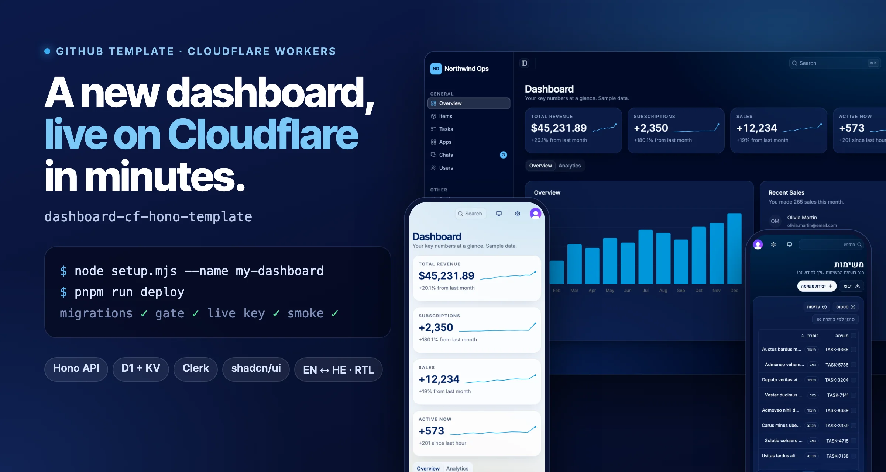
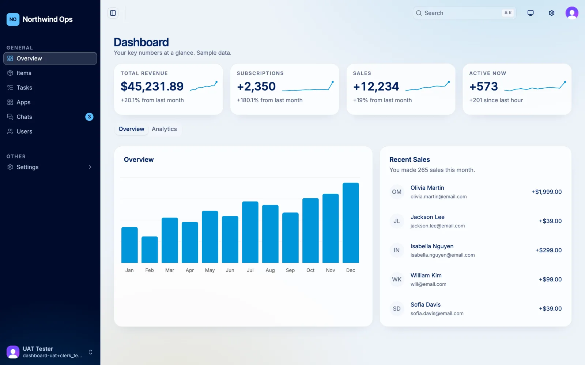
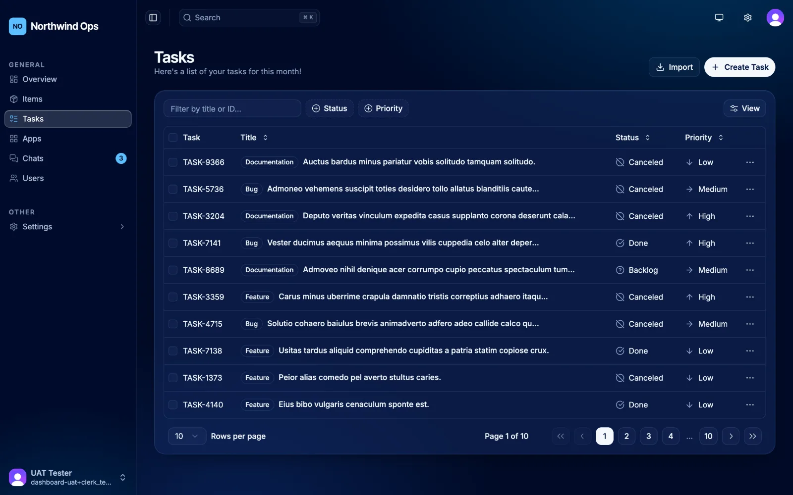
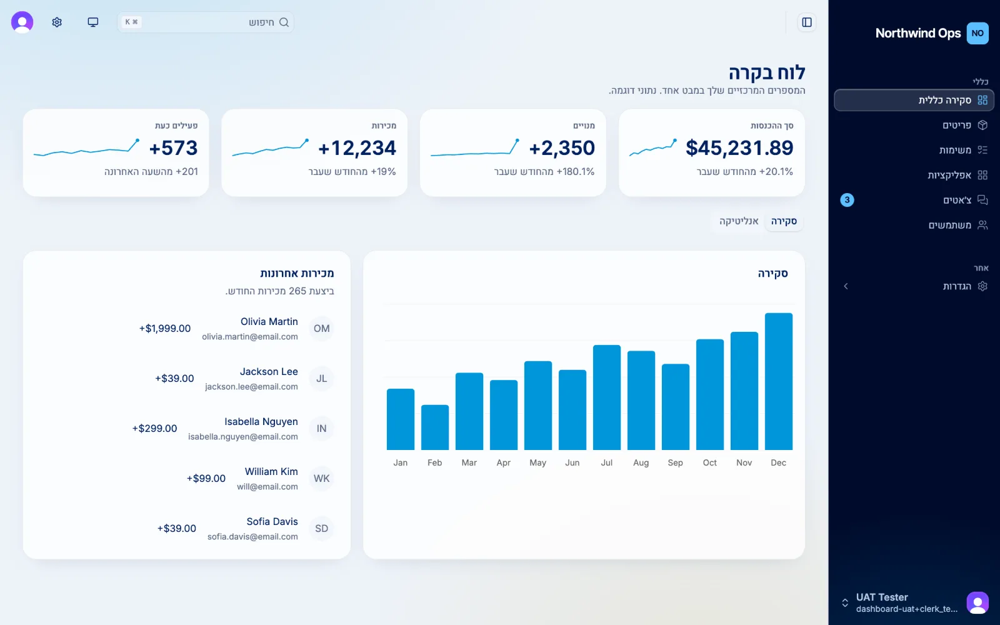
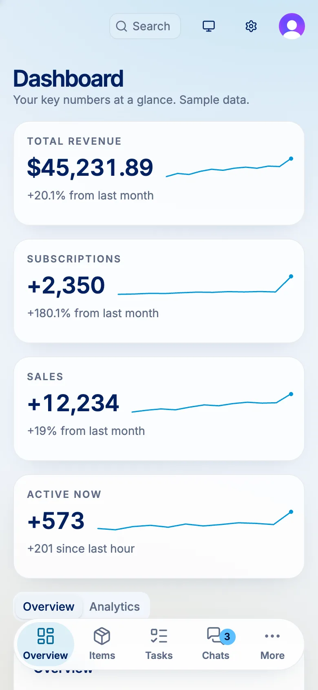
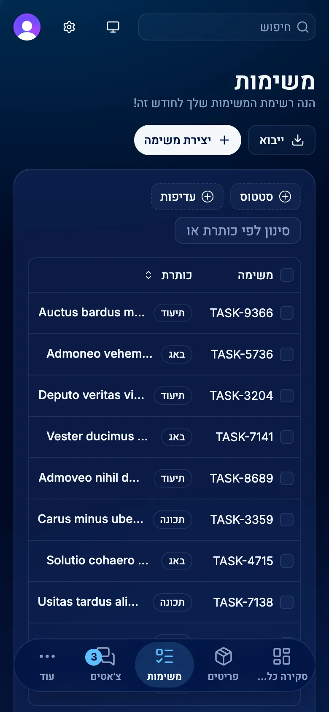
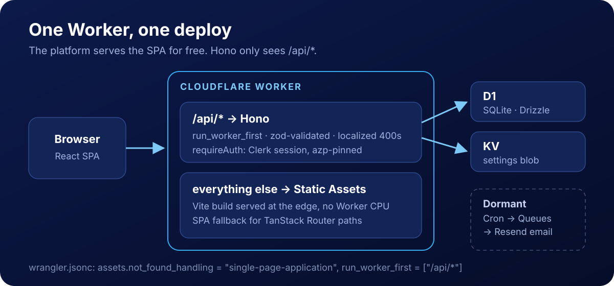

<p align="center">
  
</p>

<picture><source media="(prefers-color-scheme: dark)" srcset="https://www.shieldcn.dev/github/release/BinatrixAI/dashboard-cf-hono-template.svg?size=sm&amp;mode=dark"></picture>
<picture><source media="(prefers-color-scheme: dark)" srcset="https://www.shieldcn.dev/github/ci/BinatrixAI/dashboard-cf-hono-template.svg?variant=secondary&amp;size=sm&amp;mode=dark"></picture>
<picture><source media="(prefers-color-scheme: dark)" srcset="https://www.shieldcn.dev/badge/Language-TypeScript-3178C6.svg?logo=typescript&amp;variant=branded&amp;size=sm&amp;mode=dark"></picture>
<picture><source media="(prefers-color-scheme: dark)" srcset="https://www.shieldcn.dev/badge/Bundler-Vite-646CFF.svg?logo=vite&amp;variant=branded&amp;size=sm&amp;mode=dark"></picture>
<picture><source media="(prefers-color-scheme: dark)" srcset="https://www.shieldcn.dev/badge/Hosting-Cloudflare_Workers-F38020.svg?logo=cloudflare&amp;variant=branded&amp;size=sm&amp;mode=dark"></picture>
<picture><source media="(prefers-color-scheme: dark)" srcset="https://www.shieldcn.dev/badge/Stack-TanStack_Query-FF4154.svg?logo=reactquery&amp;variant=branded&amp;size=sm&amp;mode=dark"></picture>
<picture><source media="(prefers-color-scheme: dark)" srcset="https://www.shieldcn.dev/badge/Stack-React-61DAFB.svg?logo=react&amp;variant=branded&amp;size=sm&amp;mode=dark"></picture>
<picture><source media="(prefers-color-scheme: dark)" srcset="https://www.shieldcn.dev/badge/Stack-Tailwind_CSS-06B6D4.svg?logo=tailwindcss&amp;variant=branded&amp;size=sm&amp;mode=dark"></picture>

[English](README.md) · **Русский**

Нейтральный к бренду, переиспользуемый **шаблон дашборда на Cloudflare**. Один
Cloudflare Worker отдаёт **Vite + React SPA** (TanStack Router, shadcn/ui, Tailwind v4,
двуязычный интерфейс английский ↔ иврит с переключением языка через RTL) как
статические ассеты и направляет `/api/*` в **Hono**-API на том же
рантайме, опираясь на **D1** + **KV**, с аутентификацией **Clerk**, проверяемой на краю
сети (edge). Нажмите **Use this template**, запустите `setup.mjs`, создайте свои ресурсы —
и разверните корректно связанный дашборд в Cloudflare за считанные минуты.

> Репозиторий поставляется с сентинелами вида `__NAME__` и заглушками ID ресурсов
> `REPLACE_WITH_YOUR_*` — **никакие реальные секреты или ID аккаунтов не закоммичены**.
> `setup.mjs` подставит имена за вас; ID ресурсов вы вписываете после создания ресурсов
> D1/KV.

## Как выглядит форк

<p align="center">
  
</p>
<p align="center">
  
  
</p>
<p align="center">
  
  &nbsp;&nbsp;
  
</p>

Скриншоты демо-страниц шаблона после того, как `setup.mjs` назвал проект «Northwind Ops». Все цифры — демо-данные.

## Что вы получаете

- **Дизайн-система, а не пустая оболочка.** Тёмно-синий пресет tweakcn с KPI-карточками, спарклайнами и `Widget`, который показывает скелетон, ошибку внутри карточки и пустое состояние. Светлая, тёмная и системная темы. `setup.mjs --theme` перекрашивает всё под ваш бренд.
- **Английский ↔ иврит.** Переключатель LTR/RTL заодно меняет язык. Раскладка использует только логические CSS-свойства, а guard-тест валит сборку на физическом классе направления.
- **Мобильная оболочка.** Уже 768px сайдбар превращается в нижнюю панель вкладок с листом «Ещё» и зонами нажатия 44px.
- **Аутентификация на краю сети.** Worker проверяет сессию Clerk на каждом вызове `/api/*`, принимает только сессионные токены с ваших origin и закрывается, если список пуст.
- **Деплой, который не пропустит сломанный релиз.** `pnpm run deploy` останавливается на непримененных миграциях, проваленном quality gate или неверном ключе Clerk, затем читает живую версию и прогоняет smoke-тест.

## Требования

- **pnpm** `10.25.0` (репозиторий фиксирует `packageManager` и коммитит `pnpm-lock.yaml`)
- **Node 22** (закреплён в `.nvmrc`; Vite 8 требует Node `^20.19 || >=22.12`)
- **Аккаунт Cloudflare** (для `wrangler` + ресурсов D1/KV)
- **Приложение Clerk** (для publishable- и secret-ключей)

## Быстрый старт

> **Настраиваете новый проект?** Сначала заполните [`docs/deployment-intake.md`](docs/deployment-intake.md) — все значения проекта в порядке развёртывания — и используйте вместе с [`setup.env.example`](setup.env.example) для запуска `node setup.mjs --yes` без вопросов.

### 1. Использовать шаблон

Нажмите **«Use this template» → Create a new repository** на GitHub, затем клонируйте
свой новый репозиторий и установите зависимости:

```bash
pnpm install
```

### 2. Запустить скрипт настройки

`setup.mjs` — это одноразовый параметризатор без зависимостей. Он подставляет каждый
сентинел-идентификатор `__NAME__` (имена worker/пакета/биндингов) в значения вашего
проекта, генерирует `.dev.vars` из `.dev.vars.example`, записывает выбор переключателей
модулей и печатает чек-лист ресурсов для аккаунта.

```bash
node setup.mjs            # интерактивно в TTY
# либо полностью без диалога:
node setup.mjs --yes \
  --name my-dashboard \
  --app-name "My Dashboard" \
  --clerk-pk pk_test_your_publishable_key
```

Полезные флаги: `--d1-name`, `--kv-title`, `--theme`, `--dry-run` (предпросмотр без
записи) и `--force` (повторный запуск после появления `.setup-complete`). Запуск
**жёстко завершается с ошибкой на любом оставшемся сентинеле-идентификаторе** и сообщает
об ID ресурсов `REPLACE_WITH_YOUR_*` как о неблокирующих оставшихся действиях — их вы
заполняете на шаге 3.

### 3. Создать ресурсы Cloudflare

`setup.mjs` печатает готовый к копированию чек-лист с подставленными выбранными именами.
Он выглядит ровно так:

```bash
# 1. Создайте базу данных D1, затем вставьте возвращённый database_id в wrangler.jsonc
wrangler d1 create <your-d1-name>
#    → замените REPLACE_WITH_YOUR_D1_ID в wrangler.jsonc

# 2. Создайте KV-неймспейс, затем вставьте возвращённый id в wrangler.jsonc
wrangler kv namespace create <your-kv-title>
#    → замените REPLACE_WITH_YOUR_KV_ID в wrangler.jsonc

# Задайте ОБА секрета Clerk до первого деплоя — secret put создаёт Worker,
# если его ещё нет (wrangler отказывается деплоить с незаданным обязательным секретом)
# 3. вставьте свой ключ sk_… (никогда не коммитится; .dev.vars оставляет его пустым)
wrangler secret put CLERK_SECRET_KEY
# 4. setup.mjs печатает эту строку с уже подставленным вашим ключом
echo <your pk_…> | wrangler secret put CLERK_PUBLISHABLE_KEY

# Затем перегенерируйте типы биндингов, мигрируйте удалённый D1 и задеплойте
# 5.
pnpm cf-typegen
# 6.
pnpm db:migrate:remote
# 7.
pnpm run deploy
```

Примените миграцию базы данных к каждому окружению (они никогда не синхронизируются —
см. [`docs/data-layer.md`](docs/data-layer.md)):

```bash
pnpm db:migrate:local    # D1 в workerd/miniflare (dev, тесты, CI) — заглушка ID подойдёт
pnpm db:migrate:remote   # реальный D1 — сначала требуется настоящий database_id
```

### 4. Разработка и деплой

```bash
pnpm dev                 # HMR для SPA + Hono Worker в workerd (@cloudflare/vite-plugin)
pnpm run deploy          # с гейтами: миграции → gate → сборка → live-ключ → wrangler deploy → readback + smoke
```

Что отклоняет каждое звено — см. [Деплой с гейтами](#деплой-с-гейтами).

## Обзор архитектуры

<p align="center">
  
</p>

**Один Worker** — это весь артефакт деплоя; отдельного хоста для фронтенда нет:

- **SPA как статические ассеты.** Сборка Vite/React отдаётся на краю сети из биндинга
  `ASSETS`. Несопоставленные запросы (не к ассетам) переписываются на `index.html`
  (`not_found_handling: "single-page-application"`) для клиентской маршрутизации.
- **Hono владеет `/api/*`.** `run_worker_first: ["/api/*"]` направляет эти запросы в
  Worker (Hono) **до** фолбэка на статические ассеты; всё остальное отдаётся как ассет
  бесплатно.
- **Биндинги D1 + KV.** D1 (SQLite) — реляционное хранилище для примера CRUD над `items`;
  KV хранит отдельный blob настроек приложения. Оба объявлены в `wrangler.jsonc` с
  заглушками ID. См. [`docs/data-layer.md`](docs/data-layer.md).
- **Clerk на краю сети.** `@hono/clerk-auth` проверяет сессию Clerk внутри Worker; SPA
  использует `@clerk/react`. И publishable-, и секретный ключ — это
  `wrangler secret`.
- **Спящий асинхронный слой.** Путь Cron → Queues → Resend поставляется в
  `src/server/async/` (рабочий и покрытый юнит-тестами); обвязка платформы остаётся
  закомментированной, так что свежий форк деплоится инертным. Активируйте или удалите
  его по инструкции [`docs/async-layer.md`](docs/async-layer.md).

- **Двуязычный интерфейс (английский ↔ иврит).** Переключатель LTR/RTL заодно
  переключает язык — LTR отображает английский, RTL — иврит — через `react-i18next`
  с обоими встроенными словарями и локализованным интерфейсом Clerk (`heIL`). Новые
  строки интерфейса добавляются в оба файла `en.json` и `he.json` (проверка паритета
  это контролирует). См. [`docs/i18n.md`](docs/i18n.md).

Тема — это замена на уровне проекта (tweakcn → oklch-токены Tailwind v4), описана в
[`docs/THEMING.md`](docs/THEMING.md).

## Структура каталогов

Однопакетная раскладка — SPA, API и их общие контракты живут под одним `src/`, собираются
и деплоятся как один Worker:

```
├── src/
│   ├── client/                 # Vite + React SPA (отдаётся как статические ассеты)
│   │   ├── routes/             # файловые маршруты TanStack
│   │   │   ├── _authenticated/ #   страницы под защитой Clerk (protected)
│   │   │   └── (auth)/         #   вход / регистрация (публичные)
│   │   ├── features/           # модули-фичи (items, dashboard, settings, …)
│   │   ├── components/         # общий UI; components/ui/ = вендоренный shadcn
│   │   ├── main.tsx            # ClerkProvider + инициализация роутера
│   │   └── routeTree.gen.ts    # АВТОГЕНЕРАЦИЯ — не редактировать вручную
│   ├── server/                 # Hono API (владеет /api/*)
│   │   ├── index.ts            # регистрация роутеров = контракт порядка auth
│   │   ├── routes/             # роутеры по фичам + рядом лежащие *.test.ts
│   │   ├── middleware/         # requireAuth (шлюз на краю сети)
│   │   ├── db/                 # схема и запросы Drizzle
│   │   └── async/              # спящий слой Cron → Queues → Resend
│   └── shared/                 # Zod-схемы + типы, импортируемые обоими слоями
├── migrations/                 # сгенерированный Drizzle SQL для D1 (+ закоммиченный meta/)
├── public/                     # статические файлы, копируемые в сборку как есть
├── scripts/                    # CI-помощники гигиены (secret-grep, sentinel scan, smoke)
├── test/                       # настройка Vitest workers-pool + помощники миграций
├── docs/                       # руководства, ссылки на которые ниже
├── .claude/skills/dashboard-dev/  # скилл Claude Code: рецепты расширения шаблона
├── wrangler.jsonc              # биндинги, ассеты, run_worker_first
├── components.json             # конфиг shadcn
├── .mcp.json                   # MCP-сервер shadcn (на время разработки)
└── setup.mjs                   # одноразовый параметризатор проекта
```

## Переключатели модулей

`setup.mjs` записывает ваши намерения по модулям в `.setup-config.json` (в gitignore). Он
записывает только выбор — на этом этапе он **не** редактирует `wrangler.jsonc`:

| Переключатель       | Эффект                                                                                                                    |
| ------------------- | ------------------------------------------------------------------------------------------------------------------------- |
| **Async layer**     | Записывается сейчас; активируйте поставляемый спящий слой Cron → Queues → Resend через [`docs/async-layer.md`](docs/async-layer.md) |
| **Integration API** | **Заглушка-нооп для v2** — всегда записывается `false`; зарезервировано под будущий второй Worker                          |

## Работа с этим шаблоном (скилл Claude Code)

Репозиторий поставляется со **скиллом Claude Code `dashboard-dev`** в
[`.claude/skills/dashboard-dev/`](.claude/skills/dashboard-dev/SKILL.md). Если вы
используете Claude Code (или любого агента, читающего `.claude/skills/`), он
автоматически активируется, когда вы просите добавить страницу/маршрут, таблицу БД +
миграцию, API-эндпоинт, компонент shadcn или поработать с секретами — и отвечает точными
путями к файлам + командами именно для **этой** раскладки, а затем указывает на
подробные руководства ниже. Это самый быстрый способ разобраться в структуре, не читая
каждый документ. Не используете агента? Те же рецепты есть в `docs/` (ссылки далее).

## Документация

Подробные руководства живут в [`docs/`](docs/):

- **[`docs/adding-pages.md`](docs/adding-pages.md)** — основной how-to: анатомия
  страницы из 4 файлов и готовые к копированию рецепты для публичных/защищённых
  страниц, страницы с данными (полный путь), публичных API-эндпоинтов, данных KV и
  удаления/переименования демо-страниц.
- **[`docs/ui-components.md`](docs/ui-components.md)** — модель вендоренного shadcn/ui,
  добавление компонентов через `pnpm dlx shadcn@latest add` и MCP shadcn.
- **[`docs/i18n.md`](docs/i18n.md)** — i18n английский ↔ иврит на основе
  переключателя LTR/RTL: единая точка переключения, правило паритета обоих словарей,
  соглашение «никакого `t()` на уровне модуля» и что остаётся на английском (даты,
  графики).
- **[`docs/secrets.md`](docs/secrets.md)** — `.dev.vars` vs `wrangler secret put` vs
  `vars` в `wrangler.jsonc` vs `VITE_*`, с разобранным примером добавления секрета.
- **[`docs/THEMING.md`](docs/THEMING.md)** — темизация tweakcn + Tailwind v4: процесс
  генерация → экспорт → коммит, светлый/тёмный режим и как страницы аутентификации Clerk
  наследуют тему.
- **[`docs/data-layer.md`](docs/data-layer.md)** — D1 + KV: процесс схема → миграция
  (Drizzle + wrangler), `--local` vs `--remote` и хранилище настроек в KV.
- **[`docs/async-layer.md`](docs/async-layer.md)** — спящий слой Cron → Queues → Resend:
  активация (создать очередь + DLQ → раскомментировать обвязку → `wrangler secret put
  RESEND_API_KEY` → деплой) и заметка об удалении.

## CI/CD + деплой

### Гейт качества (GitHub Actions)

`.github/workflows/ci.yml` запускается при каждом push в `main` и на pull request'ах. Это
три параллельных задания, и они **не держат учётных данных Cloudflare — они никогда не
деплоят**:

- **quality-gate** — `cf-typegen` → `typecheck` (`tsc -b`) → `lint` → `format:check` →
  `test` (Vitest workers pool против реальных моков биндингов D1/KV, guard-тесты
  дизайн-системы, RTL-иконок, nav-контракта и CI-конфига, и jsdom-проект `client-dom`
  для компонентных тестов `*.dom.test.tsx`) → `build` → `node scripts/bundle-size.mjs`,
  который падает, если gzip-размер начального или всего JS превышает `CEILINGS`
  (поднимайте его осознанно). `cf-typegen` перегенерирует типы `Env`, и задание падает,
  если закоммиченный `worker-configuration.d.ts` устарел. Проходит зелёным на шаблоне без
  `setup` как есть.
- **secret-scan** — MIT-бинарник gitleaks (`.gitleaks.toml`) плюс проверяемый
  `scripts/secret-grep.sh` и `scripts/gitleaks-selftest.sh`, который доказывает, что
  конфиг gitleaks по-прежнему пропускает ключ `pk_` и валит ключ `sk_`.
- **sentinel-scan** — разворачивает копию дерева через `setup.mjs --yes` во временный
  каталог, затем запускает `scripts/ci-sentinel-scan.mjs` против неё (никогда напрямую по
  дереву шаблона — шаблон законно всё ещё содержит сентинелы).

### Деплой (Cloudflare Workers Builds)

Деплой — это **отдельный путь** от гейта качества. Для v1 этот шаблон поставляет
**конфигурацию сборки + эту задокументированную процедуру** — подключение репозитория к
Workers Builds делается один раз вручную в дашборде Cloudflare:

1. В дашборде Cloudflare перейдите в **Workers & Pages → ваш Worker → Settings →
   Builds** и подключите свой репозиторий GitHub.
2. Задайте **build command** `pnpm build` и **deploy command** `wrangler deploy`.
   (Скрипт пакета `deploy` — это цепочка с гейтами ниже; Workers Builds его не использует.)
3. Убедитесь, что **имя Worker совпадает с `name` в `wrangler.jsonc`** (значение, которое
   `setup.mjs` задал из `--name`), иначе Workers Builds создаст/задеплоит не тот Worker.

После этого push в `main` собирает и деплоит автоматически.

> **Workers Builds пропускает все гейты.** Он запускает `wrangler deploy` напрямую — без
> проверки миграций, гейта качества, проверки live-ключа и readback. Перед push в
> подключённую ветку запустите `pnpm run deploy` (или хотя бы `pnpm run gate` и
> `pnpm db:migrate:remote`).

### Деплой с гейтами

`pnpm run deploy` — путь с гейтами; именно так доказывается Definition of Done шаблона.
Каждое звено должно пройти, прежде чем запустится следующее:

```bash
pnpm run deploy          # guard → миграции → gate → сборка → live-ключ → wrangler deploy → readback + smoke
```

- **Guard** (`scripts/assert-run-deploy.mjs`) — отказывает, если цепочка запущена не как
  `pnpm run deploy`. Голый `pnpm deploy` — это собственная workspace-команда pnpm, а не
  этот скрипт, и она пропустила бы все гейты.
- **Миграции** (`scripts/assert-migrations-applied.sh`) — отказывает, если в удалённом D1
  не хватает миграции из `./migrations` или если удалённое состояние не удаётся прочитать.
  Исправление: `pnpm db:migrate:remote`, затем деплой снова.
- **Gate** (`pnpm run gate`) — typecheck, lint, format:check, `scripts/secret-grep.sh` и
  тесты по всему дереву. Запускайте его и отдельно перед публикацией.
- **Live-ключ** (`scripts/assert-live-key.mjs`) — отказывает, если в бандле нет вашего
  `VITE_CLERK_PUBLISHABLE_KEY` или есть любой другой ключ `pk_`, а также отказывает
  ключу `pk_test_` (development-инстанс). Чтобы намеренно задеплоить тестовый инстанс:
  `ALLOW_TEST_CLERK_KEY=1 pnpm run deploy`.
- **Readback + smoke** (`scripts/deploy-verify.mjs`) — читает обратно живую версию и
  делает smoke-тест. Базовый URL — `BASE_URL`, иначе маршрут кастомного домена, иначе
  первый `https`-origin из `AUTHORIZED_PARTIES`. При сбое печатает
  `npx wrangler rollback <version> --name <worker>` и завершается с кодом 1. Сам он
  никогда не откатывает, потому что удалённая миграция могла уже выполниться.

Первый деплой на новый кастомный домен может провалить smoke, пока DNS и сертификат
устанавливаются. Подождите минуту и перезапустите `node scripts/deploy-verify.mjs`,
прежде чем решать об откате.

Задайте оба секрета Clerk до первого деплоя: `wrangler secret put CLERK_SECRET_KEY` и
`echo <your pk_…> | wrangler secret put CLERK_PUBLISHABLE_KEY`. `secret put` создаёт
Worker, если его ещё нет.

**Существующие форки**, у которых `CLERK_PUBLISHABLE_KEY` всё ещё открытый `var`:
запустите `wrangler secret put CLERK_PUBLISHABLE_KEY` перед следующим деплоем; этот деплой
удалит старый var.

## Устранение неполадок

- **CI sentinel-scan падает на оставшемся сентинеле `__NAME__`.** Вы не запускали
  `setup.mjs` (или проскользнул новый сентинел). Запустите `node setup.mjs` — он
  перечислит каждый `file:line`, который не смог разрешить, и жёстко упадёт, пока все они
  не будут подставлены.
- **`wrangler deploy` / `--remote` падает на `REPLACE_WITH_YOUR_D1_ID` (или id KV).**
  Это намеренные заглушки. Запустите `wrangler d1 create` /
  `wrangler kv namespace create`, вставьте возвращённые `database_id` / `id` в
  `wrangler.jsonc`, затем `pnpm cf-typegen`. (Заглушка подходит для всей `--local`
  разработки, тестов и CI — реальный ID нужен только для `--remote`/продакшена.)
- **401 / аутентификация падает после деплоя.** Оба ключа Clerk — секреты Worker.
  Проверьте, что `wrangler secret list` показывает `CLERK_SECRET_KEY` и
  `CLERK_PUBLISHABLE_KEY`; недостающий задайте через `wrangler secret put <name>`.
- **Деплой отклонён на гейте миграций.** «MISSING migrations» → запустите
  `pnpm db:migrate:remote`, затем `pnpm run deploy`. «could not read the remote migration
  state» → почините чтение: `wrangler login`, сеть или реальный `database_id` в
  `wrangler.jsonc`.
- **Деплой отклонён на гейте live-ключа.** Положите ключ `pk_live_…` своего проекта в
  `VITE_CLERK_PUBLISHABLE_KEY` (`.env.local` или `.env.production.local`; переменная
  окружения shell имеет приоритет) и задеплойте снова. Ключ `pk_test_` уезжает только с
  `ALLOW_TEST_CLERK_KEY=1 pnpm run deploy`. «carries another pk_ key» значит, что vite
  прочитал не тот env-файл, который вы ожидаете.
- **Строка, записанная в dev, «пропала» в продакшене.** `--local` и `--remote` D1 — это
  две базы, которые никогда не синхронизируются; запустите `pnpm db:migrate:remote`
  (после заполнения реального `database_id`). См. [`docs/data-layer.md`](docs/data-layer.md).

## Definition of Done

Одноразовый проект, развёрнутый из этого шаблона через `setup.mjs`, деплоится вживую в
Cloudflare и:

- [ ] **Аутентификация грузится** — страница входа Clerk рендерится по развёрнутому URL.
- [ ] **Hono API отвечает** — `/api/*` возвращается из Worker (например, маршрут items
      или settings).
- [ ] **Чтение из D1 успешно** — данные примера `items` приходят из развёрнутой базы D1.
